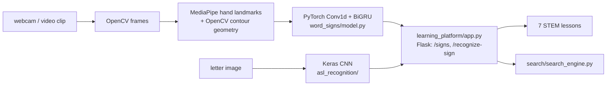

# Extending STEM across ASL

[](https://github.com/Deshraj-Jogiya/Extending-STEM-across-ASL/actions/workflows/ci.yml) 

A Flask learning platform that teaches STEM concepts in American Sign Language. It recognises STEM and computing word signs from
video (a webcam in the browser or an uploaded clip) with a PyTorch sequence model over MediaPipe hand landmarks and OpenCV contour
geometry, keeps a TensorFlow/Keras CNN for fingerspelled letters, and searches the lesson content.

The original 2023 graduate project, peer reviewed, recognised about 10 IT word signs from a small video set built for it (two videos
per sign); that data was lost in a disk failure. This rebuild uses a larger public video set: 29 signs and 214 clips from
WLASL.

## Highlights

- **Word-sign recognition from video** (`word_signs/`): every clip is read frame by frame with OpenCV; MediaPipe's hand landmarker
  finds up to two hands (21 landmarks each), made relative to the wrist and scaled by hand size; OpenCV crops each hand, segments it
  (Otsu threshold) and measures its largest contour (area share, solidity, aspect ratio, circularity, convexity defects). The
  sequence, resampled to 32 frames of 140 features, goes to a PyTorch model: a 1-D convolution over time, a bidirectional GRU and a
  linear classifier, trained with mirrored (left-handed), time-shifted and noisy copies of each clip.
- **Measured on held-out clips:** 2 clips of every sign are held out (seeded); the model trained on the rest reaches **75.9%
  top-1** and **94.8% top-3** accuracy over 29 signs (chance 3.5%), with a confusion matrix in `exports/`.
- **Webcam in the browser** (`/signs`): the page records two seconds with `getUserMedia`, sends 30 JPEG frames to `/recognize-sign`
  and shows the top three signs. OpenCV decodes and downsizes the frames; a two-second recording is recognised in a median 1.1 s on a
  laptop CPU (about 33 ms per frame, nearly all in the hand landmarker, which is built once and reused across
  requests), with the time per stage returned alongside the answer (`word_signs/latency.py`).
- **Gesture redundancy, measured** (`word_signs/redundancy.py`): each clip's hand shape is how far each finger is bent and spread
  while the sign is held; two signs share a hand shape when a permutation test cannot tell their clips apart (p ≥ 0.05), for
  example computer and network, chemistry and picture, or machine, paper and school. The 29 signs use 18 distinct hand shapes, so a lesson that teaches each shared shape once has
  **38% fewer hand shapes** to practise.
- **Fingerspelling CNN:** a TensorFlow/Keras CNN (3 convolution blocks, 64×64 greyscale input, 26 letters) behind `/recognize`
  (`asl_recognition/`), trained on generated images so the pipeline runs anywhere.
- **Learning platform:** Flask lessons for 7 STEM concepts (`learning_platform/`), plus lesson search that merges concepts sharing a
  hand shape (`search/`).
- **Original results (2023):** feedback from 50+ STEM students and a 4.6/5 satisfaction score; the survey responses are not stored
  here.
- **Tests and CI:** pytest covers the landmark normalisation, contour features, resampling, mirroring, the split, the model and the
  Flask route; GitHub Actions runs them and the original smoke tests.

## Architecture



## Stack

Python, PyTorch, MediaPipe, OpenCV, TensorFlow/Keras, Flask, NumPy, SciPy, pytest, GitHub Actions.

## Run it

```bash
pip install -r word_signs/requirements.txt
python -m word_signs.download data/wlasl          # WLASL clips for the vocabulary (non-commercial licence)
python -m word_signs.build_dataset data/wlasl     # hand features -> word_signs/data/features.npz
python -m word_signs.evaluate                     # train, test on held-out clips, save the model
python -m word_signs.redundancy                   # shared hand shapes
python learning_platform/app.py                   # then open http://localhost:5000/signs
python -m pytest -q tests
```

The fingerspelling CNN and the lesson search run from the main requirements:

```bash
pip install -r requirements.txt
python asl_recognition/dataset.py
python asl_recognition/model.py
python search/search_engine.py
```

## Data

- **Word signs:** clips from WLASL (Li et al., 2020) through the Hugging Face mirror `Voxel51/WLASL`, for 29 STEM and
  computing signs (214 clips, 6 to 14 per sign). WLASL is licensed for non-commercial computational use (C-UDA), so the clips
  are not in this repository; the extracted hand features are (`word_signs/data/features.npz`), so the model can be trained and
  tested without the videos. The mirror gives no signer ids, so the hold-out is by clip, not by signer: a held-out clip's signer may
  appear in training.
- **Hand landmark model:** MediaPipe's `hand_landmarker.task` (Apache 2.0), in `word_signs/models/`.
- **Letters:** the fingerspelling dataset step generates synthetic images so the pipeline runs anywhere.
