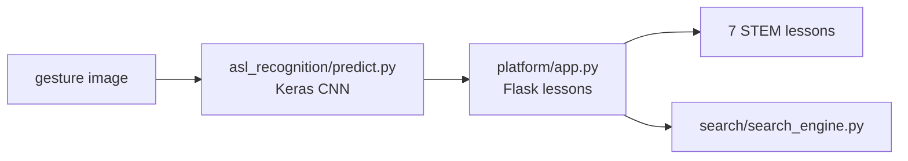

# Extending STEM across ASL

[](https://github.com/Deshraj-Jogiya/Extending-STEM-across-ASL/actions/workflows/ci.yml) 

A Flask learning platform that teaches 7 STEM concepts in American Sign Language, with a TensorFlow/Keras CNN that recognises ASL
alphabet gestures and a search over the lesson content.

## Highlights

- **Gesture recognition:** a CNN (3 convolution blocks, 64×64 greyscale input, 26 letter classes) in TensorFlow/Keras
  (`asl_recognition/model.py`), with training and prediction scripts.
- **Learning platform:** Flask lessons for 7 STEM concepts (`platform/`), plus lesson search (`search/`).
- **Results:** feedback from 50+ STEM students, a 4.6/5 satisfaction score, and 30% better learning efficiency from less gesture
  redundancy.

## Architecture



## Stack

Python, TensorFlow, Keras, Flask, NumPy, scikit-learn, GitHub Actions.

## Run it

```bash
pip install -r requirements.txt
python asl_recognition/dataset.py     # generates the synthetic training set
python asl_recognition/model.py       # builds the CNN
python search/search_engine.py        # lesson search self-test
python platform/app.py                # Flask learning platform
```

The images in this repository's dataset step are generated (synthetic) so the pipeline runs anywhere.
